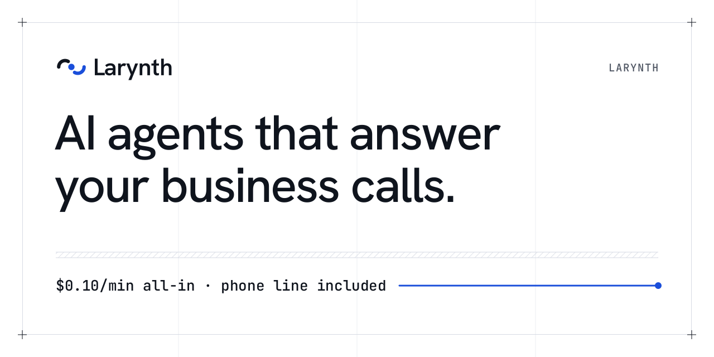

Larynth builds AI voice agents that answer your business calls. An agent picks up every call, answers from your own documents and website, books appointments, and hands the caller to a person when they ask. Simple per-minute pricing, with an API, SDKs and an MCP server for developers.

- Website: [larynth.com](https://larynth.com)
- Docs and API reference: [docs.larynth.com](https://docs.larynth.com)
- Status: [status.larynth.com](https://status.larynth.com)

## Contact

Support: support@larynth.com. Security reports: security@larynth.com, or a private advisory on the affected repository.
